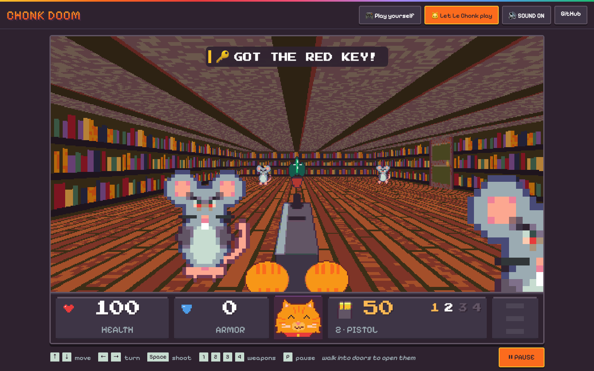
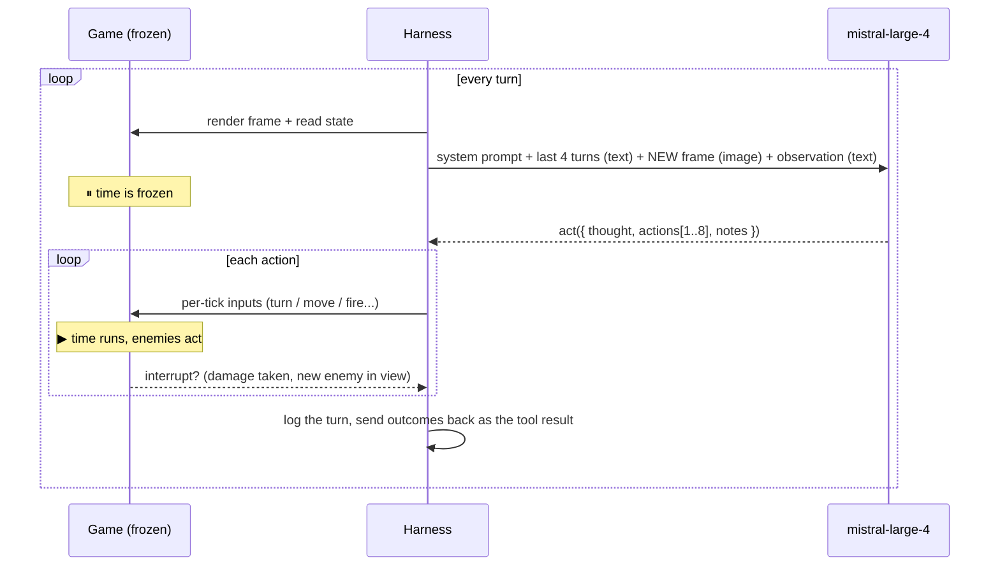
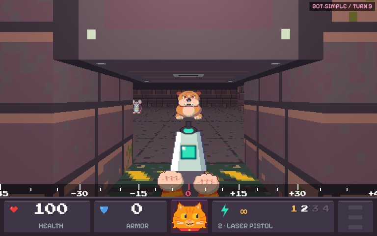

<p align="center"></p>

# CHONK DOOM

**A DOOM-like first-person shooter starring Le Chonk, and a harness that lets _Mistral Large 4_ play it by itself.**

> Entry for the Mistral AI Discord challenge **"Le Chonk wants to play"** ([brief](docs/CHALLENGE.md)).

▶️ **Play it / watch Le Chonk play:** https://goums.github.io/chonk-doom/ <br>
📊 **How it works + benchmark (project page):** https://goums.github.io/chonk-doom/about.html <br>
🎬 **Video:** _coming soon_



The house has been invaded by angry dogs and mice. Le Chonk, a very large and very proud orange tabby, grabs his pistol.
There are three levels (Le Salon → La Cuisine → La Cave), a classic DOOM arsenal (fist, pistol, shotgun, chaingun), colored keys and
locked doors, secret walls, explosive barrels, and **REX**, an armored Doberman boss. Everything (textures, sprites, the Doom-style
reactive face, music, sound effects) is **generated procedurally at runtime**: the repo contains no image or audio assets.

| Challenge criterion | How CHONK DOOM answers it |
|---|---|
| **Complexity** | A real-time 3D first-person shooter. The agent has to perceive enemies from raw pixels, aim, dodge projectiles, explore a maze with locked doors, keys and secrets, manage health and ammo, pick the right weapon, and beat a boss. |
| **Performance** | A headless benchmark: N episodes per level and per configuration (completion %, kills %, deaths, turns, cost), **ablations** (vision only / + automap / + radar, reasoning on/off), and scripted baselines. See [Results](#-results). |
| **Reproducibility** | Zero install: open the site, paste a Mistral key and press **Let Le Chonk Play**. Locally it's `npm run dev` or `npm run bench`. Every turn is logged (thought, actions, outcomes, the exact frame the model saw). |

---

## 🧰 Tech stack

| Layer | Tech |
|---|---|
| Language | **TypeScript** (strict), ES2022 modules, no framework |
| 3D rendering | **[three.js](https://threejs.org)** r186: merged wall/floor geometry, billboard sprites, point lights, fog. Rendered at 576×300 and upscaled ×2 with nearest-neighbour filtering |
| Pixel art | **Canvas 2D**: every texture, enemy, item, weapon and face is drawn in code, then snapped to the [Resurrect 64](https://lospec.com/palette-list/resurrect-64) palette with hue-shifted shading and selective colored outlines (modern pixel-art techniques) |
| HUD / UI | Canvas 2D composited at 3× for crisp text. [Pixelify Sans](https://fonts.google.com/specimen/Pixelify+Sans) for words, [Press Start 2P](https://fonts.google.com/specimen/Press+Start+2P) for numbers (no `5`/`S` or `0`/`O` confusion, for humans *and* for the model) |
| Audio | **Web Audio API** + **[ZzFX](https://github.com/KilledByAPixel/ZzFX)** sound effects, and a tiny custom 4-channel chiptune sequencer playing 4 original tracks |
| Game engine | Custom deterministic fixed-timestep simulation (60 Hz): grid collision, DDA raycasting, flow-field enemy pathing, hitscan + projectiles |
| AI model | **Mistral Large 4** (`mistral-large-4`): image input, **function calling** (one `act` tool, `tool_choice: "any"`), optional `reasoning_effort: "high"` |
| AI API + client library | The **Mistral chat completions REST API** ([Mistral Studio](https://docs.mistral.ai)), or the OpenAI-compatible **[OpenRouter](https://openrouter.ai) API** to compare other models. Called with our own tiny typed `fetch` client ([`src/agent/mistral.ts`](src/agent/mistral.ts), ~150 lines, no SDK) so the same code runs in the browser and in Node, handles both providers' small differences (image parts, `tool_choice`, reasoning switches), retries rate limits with backoff and records the real per-request cost |
| Harness runtime | Runs **in the browser**, with no backend (both APIs allow CORS). In local dev, a Vite middleware proxies requests and adds the API key from `.env` on the server side |
| Evals | **[Evalite](https://www.evalite.dev)** (TypeScript-native LLM eval runner built on Vitest): scored unit tests of the model's perception and decisions on real game situations, per model. See [Evals](#-evals) |
| Benchmark | **[Playwright](https://playwright.dev)** headless Chromium + a Vite dev server, running parallel episodes in **turbo mode** (simulate as fast as possible, render only when the model looks) |
| Build / hosting | **[Vite](https://vitejs.dev)** 8 → a static site, deployed to **GitHub Pages** by GitHub Actions |

---

## 🧠 How the harness works

### The core idea: freeze time while Le Chonk thinks

A frontier model needs a few seconds per decision, and a shooter runs at 60 fps. Making the model play in real time would be unfair
and would mostly measure latency, so **the game is turn-based for the agent**:



The world is only frozen while the model *thinks*. While Le Chonk's actions execute, it runs normally: mice throw cheese, bulldogs charge,
chihuahuas fire sonic yaps. Decisions have real consequences, and the model has to plan short sequences that hold up.

### 1. What the model sees

Each turn, the user message contains **one image and one text observation**. The example below was captured by
[`bench/snap.mjs`](bench/snap.mjs) at the moment a `go_to` got interrupted because two enemies came into view.

**The frame** (768×480, exactly as sent):



- A **degree ruler** is drawn along the bottom of the 3D view (−45° … +45°, a tick every 5°, red `0` = crosshair). It turns *"where is
  the enemy in the picture?"* into *"how many degrees should I turn?"*. That's the grounding idea of the Mistral object-detection
  cookbook, made part of the game UI. Here the bulldog stands right on `0` and the mouse is around `−25`.
- The status bar (health, armor, weapon + ammo, owned weapon slots, keys) and Le Chonk's face are part of the image too.

**The text observation** (captured at the same instant):

```text
=== TURN 12 | E1M1 LE SALON (The Living Room) ===
Objective: Find the RED key, open the red door (south hallway) and hit the EXIT switch.
Health 100% | Armor 0% | Weapon: PISTOL (74 bullets)
Weapons owned: 1=FIST, 2=PISTOL
Ammo: bullets 74, shells 0 | Keys: none
Position: x=7.5, y=10.3 (tile 7,10), facing SOUTH (heading 180°)
Kills 1/16 | Items 2/10 | Secrets 0/0 | Level time 13s
2 enemy(s) visible on screen right now.
Automap (explored area):
             1111111111222222222
   01234567890123456789012345678
 0  ##########
 1 #...+......#
 2 #..........#
 3 #..........D
 4 #..o....o..#
 5 #..........#
 6 #..........#
 7  ####/############D#  ##  #
 8 #...........................+
 9 #..o.......................o.
10 #......v.....................
11  ######D##############R##  #
12       ...
13       ...
14       ...
15      .....
16      .....
17      .....
18      .....
19     #......
20     .......
21     .......
22     ...r....
23     ########
Nearest unexplored frontier tiles: (6,12) (8,12) (6,13) (8,13) (6,14) (8,14)
Closed doors you know: (7,11) door; (11,3) door; (18,7) door; (22,11) RED door, LOCKED (need the red key). Open one with go_to to its coordinates (or walk into it).
Your notes: (empty)
```

Below the automap, the observation also lists the **closed doors** and **items** Le Chonk has seen, with exact coordinates, so the
model doesn't have to count columns in the ASCII map (an early Mistral Large 4 run walked to the wrong tile because of that).

The automap is an ASCII version of DOOM's automap, built only from tiles Le Chonk has actually seen (`v` = Le Chonk facing south,
`D` door, `R` red locked door, `/` open door, `+` health, `a` ammo, `o` obstacle). In the default mode, **enemies never appear in the
text**: the model only learns *how many* are on screen, and has to find them in the image.

### 2. What the model does: one `act` tool

The model must call a single function:

```json
{
  "thought": "Mon dieu, a bulldog right at 0 and a sneaky mouse at -25! The bulldog first, before it bites my magnificent tail.",
  "actions": [
    { "type": "attack", "degrees": 0, "shots": 4 },
    { "type": "move", "tiles": -1.5 },
    { "type": "attack", "degrees": -25, "shots": 2 }
  ],
  "notes": "Red door at (21,11). Unexplored: east hallway. Health at (29,8)."
}
```

| Action | Effect |
|---|---|
| `turn {degrees}` | Rotate (+ right, − left), read off the ruler |
| `move {tiles}` / `strafe {tiles}` | Walk forward/back or sidestep, with collision |
| `attack {degrees, shots}` | Turn, then fire N times: the main combat move |
| `shoot {shots}` | Fire without turning |
| `go_to {x, y}` | Walk the shortest **known** path to an explored automap tile, opening unlocked doors on the way |
| `explore {tiles}` | Auto-explore: keep walking to the nearest unexplored area (opening doors) until an enemy appears, Le Chonk gets hurt, or a new item comes into view |
| `use` | Open a door or press the EXIT switch in front |
| `weapon {slot}` | 1 FIST · 2 PISTOL · 3 SHOTGUN · 4 CHAINGUN |
| `wait {seconds}` | Let enemies come around the corner |

- **`thought`** is required. It's shown live as Le Chonk's speech bubble, so you can follow its reasoning while watching.
- **`notes`** is the model's long-term memory. It rewrites it whenever it wants, and it's shown back every turn.

### 3. How actions run, with interrupts

`ActionExecution` ([actions.ts](src/agent/actions.ts)) turns each macro-action into per-tick inputs for the same game engine humans use.
It reports a plain-language **outcome** for each action, and the outcomes become the tool result of the turn. The turn that produced the
frame above came back as:

```text
1. {"type":"go_to","x":7,"y":11} -> INTERRUPTED: 2 new enemy(s) came into view.
2. -> 1 remaining action(s) skipped.
```

**Movement is interruptible.** As soon as Le Chonk takes damage or a new enemy enters the view, the action stops, the rest of the
queue is dropped, and the model gets a fresh frame. It works like a reflex: the model can queue a long `go_to` and still react the
instant something shows up. Combat actions (`attack`, `shoot`) are not interruptible, so a volley is always completed. Other outcomes
look like `BLOCKED after 0.5 tiles`, `Fired 4 shot(s) with SHOTGUN: 3 hit(s), 1 kill(s)` or `This door is locked. You need the RED key.`

**Plan ahead, react instantly.** Because interrupts make long plans safe, the prompt asks for **long plans when it's calm** (up to 8
actions: `explore`, `go_to` a key, `go_to` the door, `explore` again…) and **short reactive plans in combat** (attack, strafe, attack).
That cuts the number of model calls, and with it the latency and cost, without making Le Chonk blind to danger.

### 4. Context and memory management

| What | Policy |
|---|---|
| System prompt | Rules, actions, enemies, weapons, tips, persona. Stable, so it benefits from prompt caching |
| History | The last **4 turns**, as *text only* (observation without the automap, the `act` call, the outcomes) |
| Images | **Only the current frame** is sent. Older frames are dropped to keep each turn at ~3-4k tokens |
| Long-term memory | The model's own `notes` (≤ 600 chars), shown every turn |
| Stuck detection | If Le Chonk stays within ~1 tile for 8 turns with no enemies around, the observation says so |
| Death | The level restarts with the inventory Le Chonk entered it with. History is cleared, and the next observation explains what happened |
| Robustness | Retries with backoff on 429/5xx. If the model returns no valid `act`, the turn becomes a short `wait` and is logged as an error |

### 5. Observation modes (ablations)

| Mode | Frame | Status text | Automap + frontier | Enemy radar (exact angles) |
|---|---|---|---|---|
| `vision` | ✅ | ✅ | ❌ | ❌ |
| `map` (default) | ✅ | ✅ | ✅ | ❌ |
| `radar` | ✅ | ✅ | ✅ | ✅ |

Combined with `reasoning: none | high`, this measures how much the model relies on its eyes versus structured text, and how much
thinking helps in a fast-paced game.

### 6. Game design choices made for an AI player

- **Time freezes** while the model thinks. Difficulty (Easy / Medium / Hard) scales damage taken and enemy aggression.
- **Macro-actions + interrupts** instead of raw key presses.
- **Doors open when you walk into them**, and `go_to` opens them automatically. This avoids a failure mode where the model sees a door but can't line up perfectly with it.
- **Clear silhouettes and a limited palette**, so enemies and items stand out in a low-resolution frame. **Unambiguous digits** on the ruler and HUD.
- **Readable, plain-language feedback** for every action.
- **The same engine for humans and agents**: the agent drives the game through the same input interface as the keyboard.

---

## 📊 Results

### Mistral family (Mistral Studio, instruct, Medium difficulty, 2 runs per level)

| Model | Levels cleared | Level 1 | Level 2 | Level 3 | Cost per level | s / decision | Aim error (median) | Hit rate |
|---|---|---|---|---|---|---|---|---|
| **Mistral Large 4** 🐱 | **5/6** | 2/2 | 1/2 | 2/2 | $0.15 | 5.5 | 6.7° | 35% |
| Mistral Large 3 | **0/6** | 0/2 | 0/2 | 0/2 | $0.32 | 6.0 | 25.5° | 30% |
| Mistral Small 4 | **0/6** | 0/2 | 0/2 | 0/2 | $0.08 | 1.5 | 19.8° | 22% |
| Ministral 14B | **0/6** | 0/2 | 0/2 | 0/2 | $0.09 | 3.2 | 21.5° | 22% |

Per-level details for **clearing Level 1** (Mistral Large 4, mean of the cleared runs):

| Turns | Actions | Game time | Wall time | Tokens in / out | Cost | Hit rate | Aim error | Damage taken | Deaths | Kills |
|---|---|---|---|---|---|---|---|---|---|---|
| 28 | 74 | 1:43 | 2:15 | 149k / 6.6k | $0.105 | 48% | 8.1° | 148 | 0.0 | 100% |

**Takeaways.** Mistral Large 4 clears **5 of 6** levels including the Rex boss fight; its predecessor (Large 3) and its smaller siblings clear **none**, even though they score only a little lower on the static evals below. Playing a real-time FPS end-to-end (perception + aiming + navigation + survival) separates the models much more than single-shot tests. Large 4 is also the **cheapest per cleared level**: Large 3 burns more turns and tokens without finishing.

Scripted baselines: `bot:random` 0/3 levels; `bot:simple` (cheats: reads exact enemy positions) 3/3, which proves every level is beatable through the action API.

> The open-weight comparison against Qwen3-VL, Llama 4, DeepSeek V4.1 and GLM-5.3 (OpenRouter, two leagues: instruct and reasoning) is wired up (`npm run bench -- --provider openrouter …`) and will be added here.

Every cleared run can be **replayed** in the game (Let Le Chonk Play → Watch Replay): the engine is deterministic, so the recorded seed + decisions re-simulate the exact same game, with Le Chonk's original thoughts.

## 🧪 Evals

Beyond full-game episodes, CHONK DOOM ships **LLM evals** written with **[Evalite](https://www.evalite.dev)** (TypeScript, built on
Vitest). They are scored unit tests of the two skills the harness depends on, on **real game situations**:

- [`evals/make-dataset.mjs`](evals/make-dataset.mjs) stages scenes in the actual engine (Playwright) and records the **exact frame +
  observation** the model would receive, with a ground truth → [`evals/dataset.json`](evals/dataset.json).
- [`evals/aim.eval.ts`](evals/aim.eval.ts): **Aim with the degree ruler**. One enemy (mouse, bulldog or chihuahua) at a known angle
  from −30° to +33°. Scorers: valid `act()` call, aim accuracy (≤ 5° error = 1, ≥ 20° = 0), shoots.
- [`evals/decide.eval.ts`](evals/decide.eval.ts): **Make the right move**. Locked red door + red key seen → go get the key; 15% health
  + food seen → go eat; red key in hand → go to the red door; nothing known → explore; bulldog charging → shoot it; EXIT switch in
  front → press it.
- Every model runs as an Evalite **variant** on the same cases, with the same prompt and tool as the game.

| Model | Aim (ruler reading) | Decisions | Overall | Avg latency |
|---|---|---|---|---|
| **Mistral Large 4** | 95% | 88% | **92%** | 8.9 s |
| Mistral Large 3 | 83% | 94% | **88%** | 7.4 s |
| Mistral Small 4 | 74% | 90% | **81%** | 1.7 s |
| Ministral 14B | 78% | 82% | **79%** | 3.0 s |

<sub>Mistral Studio, 3 trials per case, reasoning off ([raw export](evals/results/mistral.json)).</sub>

```bash
npm run eval:data                                   # regenerate the dataset from the game
npm run eval                                        # run all evals (models from EVAL_MODELS, keys from .env)
EVAL_MODELS=mistralai/mistral-large-4-0 npm run eval
EVAL_PROVIDER=mistral EVAL_MODELS=mistral-large-4 npm run eval   # straight to Mistral Studio
npx evalite serve                                   # browse every case, frame and answer in the Evalite UI
```

## 🚀 Setup

### Option A: no install (GitHub Pages)
1. Open https://goums.github.io/chonk-doom/
2. Click **Let Le Chonk Play**, pick **Mistral Studio** or **OpenRouter**, and paste your API key (from
   [console.mistral.ai](https://console.mistral.ai) or [openrouter.ai/keys](https://openrouter.ai/keys)). It's stored only in your
   browser's localStorage and sent only to that provider.
3. Pick the difficulty, observation mode and reasoning, then **Start Le Chonk**.

> The model must be `mistral-large-4` (**not** `mistral-large-latest`), and your workspace needs access to it in Mistral Studio.
> Any other Mistral vision + function-calling model also works (e.g. `ministral-14b-latest`); just change the Model field.

### Option B: local dev
```bash
git clone https://github.com/goums/chonk-doom && cd chonk-doom
npm install
echo "MISTRAL_STUDIO_API_KEY=your_key" > .env   # read by the dev proxy only, never bundled
echo "OPEN_ROUTER_API_KEY=your_key" >> .env    # optional: compare other models via OpenRouter
npm run dev                                     # http://localhost:5173
```

### Option C: benchmark (headless)
```bash
npx playwright install chromium
npm run bench -- --models mistral-large-4 --obs map --reasoning none --levels 0,1,2 --runs 5 --parallel 3
npm run bench -- --provider openrouter --models mistralai/mistral-large-4-0,google/gemini-3.8-flash --runs 3   # model comparison
npm run bench -- --models bot:simple,bot:random --runs 3          # baselines
npm run bench -- --obs vision,map,radar --reasoning none,high     # ablations
```
Each episode is one level, capped at 150/220/260 turns and 3 deaths. Results go to `runs/<date>/`: one JSON log per episode (every turn,
with frames) plus `summary.md`. `node bench/snap.mjs` regenerates the README images and the favicon.

### Playing yourself
↑↓ move · ←→ turn · **Space** shoot · 1-4 weapons · P pause. Walk into doors and the EXIT switch to use them.

---

## 🛠 How it was developed

- **Team:** 1 person ([@goums](https://github.com/goums), [uplab](https://uplab.fr)) + **Claude Code** (Anthropic) as the coding agent, which wrote most of the code from the design brief and iterated on feedback.
- **Players:** in agent mode, every in-game decision is made by **Mistral Large 4** (`mistral-large-4`). The scripted bots are only baselines, and other models (via OpenRouter) are only used for comparison.
- **Open source used:** three.js (MIT), ZzFX (MIT), Vite (MIT), Playwright (Apache-2.0), Evalite + Vitest (MIT), the Resurrect 64 palette by Kerrie Lake, and the Pixelify Sans and Press Start 2P fonts (OFL).
- **Original work:** the game design, levels, all art (drawn procedurally in code), the 4 music tracks and the harness. DOOM is the obvious inspiration, but no DOOM code or assets are used. Le Chonk's look follows the official Mistral Large 4 mascot palette.

## License
MIT
