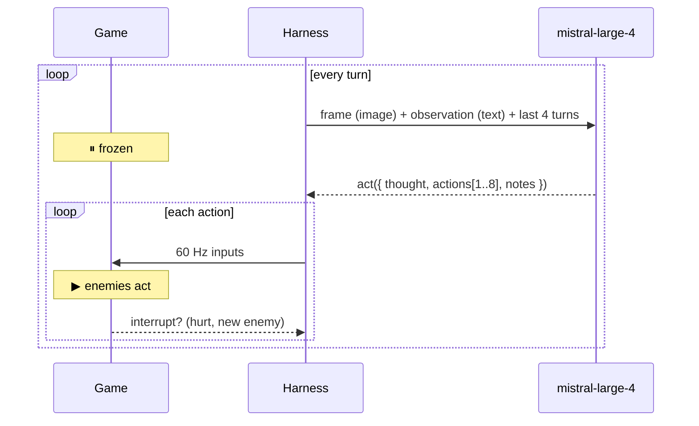
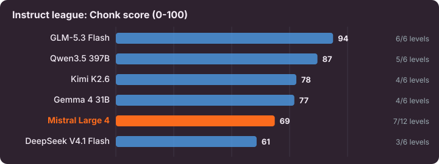
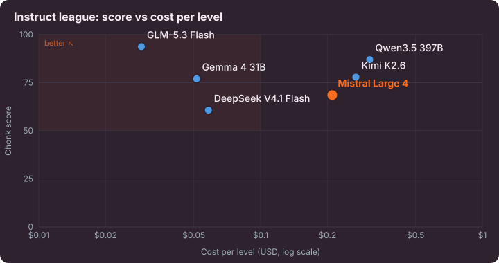
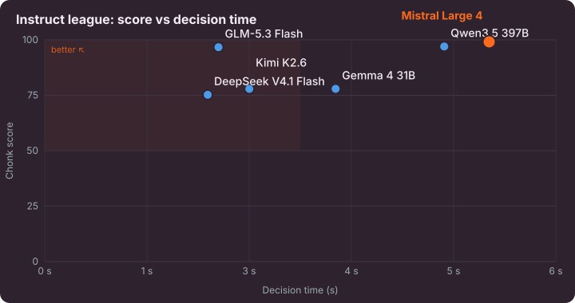
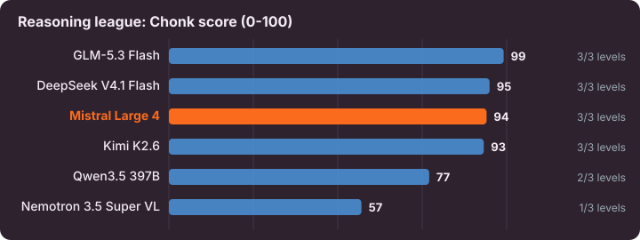
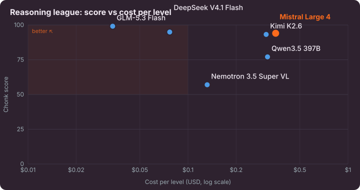
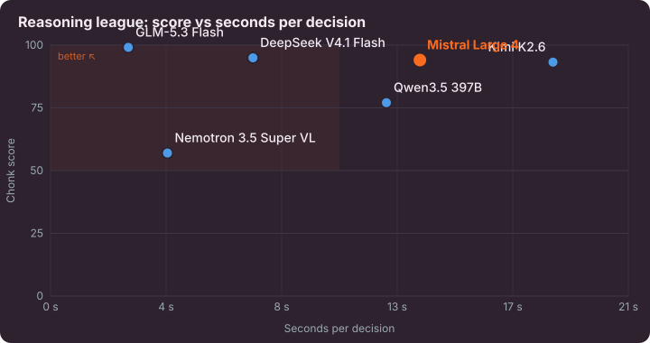

<p align="center"></p>

# CHONK DOOM

**A DOOM-like FPS starring Le Chonk. Mistral Large 4 plays it by itself.**

> Entry for the Mistral AI Discord challenge **"Le Chonk wants to play"** ([brief](docs/CHALLENGE.md)).

▶️ **Play / watch:** https://goums.github.io/chonk-doom/ <br>
📊 **Project page:** https://goums.github.io/chonk-doom/about.html <br>
🎬 **Video:** _coming soon_


Angry dogs and mice invaded the house. Le Chonk grabs his laser pistol.

- 3 levels: Le Salon → La Cuisine → La Cave.
- DOOM arsenal: fist, laser pistol, shotgun, chaingun.
- Keys, locked doors, a secret, explosive barrels, and **REX**, the boss.
- All art, music and sounds are generated in code. No asset files.

| Criterion | Answer |
|---|---|
| **Complexity** | Real-time 3D shooter. Pixels in, aim, dodge, explore, manage health, beat a boss. |
| **Performance** | Mistral Large 4 vs Kimi, Qwen, DeepSeek, GLM, Gemma, Nemotron. 2 leagues. Score, cost, speed, aim. |
| **Reproducibility** | Deterministic engine. Every run is a replayable log. Zero-install replays on the site. |

---

## 🧠 The harness

**Time freezes while Le Chonk thinks.** Then his actions run in real time, and enemies fight back.



### What he sees


- **Degree ruler** under the view: −45° … +45°, red `0` = crosshair. "Where is it?" becomes "turn −25°".
- HUD and face are in the image too.

Plus a text observation (excerpt):

```text
=== TURN 10 | Level 1 · LE SALON (The Living Room) ===
Health 100% | Armor 0% | Weapon: LASER PISTOL (unlimited energy)
Position: x=7.5, y=10.3 (tile 7,10), facing SOUTH (heading 180°)
2 enemy(s) visible on screen right now.
Automap (explored area):
   01234567890123456789012345678
 7  ####/########### D#####
 8 #..a........................+
 9 #..o.......................o.
10 #......v.....................
11  ######D##############R####
Closed doors you know: (7,11) door; (22,11) RED door, LOCKED (need the red key).
Items you have seen: bullets at (3,8); RED KEY at (7,22).
EXIT switch not seen yet: keep exploring.
```

Enemies are never listed in the text. He must find them in the image.

### What he does

One forced tool call per turn:

```json
{
  "thought": "Miaou! Bulldog at 0, sneaky mouse at -25. Pew pew! Bulldog first!",
  "actions": [
    { "type": "attack", "degrees": 0, "shots": 4 },
    { "type": "strafe", "tiles": -1 },
    { "type": "attack", "degrees": -25, "shots": 2 }
  ],
  "notes": "Red door at (22,11). Red key at (7,22)."
}
```

| Action | Effect |
|---|---|
| `attack {degrees, shots}` | Turn by the ruler angle, then fire |
| `explore {tiles}` | Walk into the unknown until something happens |
| `go_to {x, y}` | Shortest known path. Presses doors and the EXIT |
| `move` / `strafe {tiles}` | Walk, back off, sidestep |
| `turn` / `shoot` / `use` | Fine control |
| `weapon {slot}` | 1 fist · 2 laser · 3 shotgun · 4 chaingun |
| `wait {seconds}` | Ambush |

- `thought` is shown live in his speech bubble, in a big-fat-French-cat voice.
- `notes` is his memory, shown back every turn.

### Rules that make it work

- **Interrupts.** Movement stops when he's hurt or sees a new enemy. Combat stops after 10 damage.
- **Plan long when calm, short in combat.** Fewer calls, lower cost, still reactive.
- **Exact coordinates** for known doors, items and the EXIT. No column counting.
- **Attacker angles** in damage events: "bite at −110°, turn −110° to face it".
- **Context:** last 4 turns as text, only the current image (~4k tokens per turn).
- **Death:** level restarts at 100 HP.

---

## 📊 Benchmark

Same game, harness and prompt. Only the model changes.

- Open-weight models only. Mistral Large 4 via Mistral Studio, rivals via OpenRouter.
- Two leagues: reasoning and non-reasoning are never mixed.
- Medium difficulty. Best run per level for each model. Caps: 150 / 220 / 260 turns, 3 deaths.
- **Chonk score** per level: 60 points for clearing it + 40 × share of enemies killed (best attempt).

<!-- bench:start -->
### Instruct league (reasoning off)



| Model | Score | Levels cleared | Cost / level | Decision time | Aim error |
|---|---|---|---|---|---|
| **Mistral Large 4** 🐱 | **99** | 3/3 | $0.13 | 5.6 s | 6.0° |
| Qwen3.5 397B | **97** | 3/3 | $0.18 | 5.0 s | 5.9° |
| GLM-5.3 Flash | **97** | 3/3 | $0.03 | 2.2 s | 4.9° |
| Gemma 4 31B | **78** | 2/3 | $0.04 | 3.7 s | 3.2° |
| Kimi K2.6 | **78** | 2/3 | $0.23 | 2.6 s | 5.7° |
| DeepSeek V4.1 Flash | **75** | 2/3 | $0.07 | 2.1 s | 9.0° |

 

### Reasoning league (reasoning effort high)



| Model | Score | Levels cleared | Cost / level | Decision time | Aim error |
|---|---|---|---|---|---|
| GLM-5.3 Flash | **99** | 3/3 | $0.03 | 2.8 s | 4.8° |
| DeepSeek V4.1 Flash | **95** | 3/3 | $0.08 | 7.3 s | 4.3° |
| **Mistral Large 4** 🐱 | **94** | 3/3 | $0.35 | 13.3 s | 7.2° |
| Kimi K2.6 | **93** | 3/3 | $0.31 | 18.1 s | 3.3° |
| Qwen3.5 397B | **77** | 2/3 | $0.31 | 12.1 s | 7.1° |
| Nemotron 3.5 Super VL | **57** | 1/3 | $0.13 | 4.2 s | 7.5° |

 
<!-- bench:end -->

Every cleared run can be replayed in the game (**Let Le Chonk Play → Watch Replay**). Same seed + same decisions = same game.

📦 **Full traces** (every episode, every frame sent to the model): [benchmark release](https://github.com/goums/chonk-doom/releases/tag/benchmark-2026-10-20).

## 🧪 Evals

14 staged scenes from the real engine, 3 trials each.

- **Aim:** one enemy at a known angle. Score = aim error (≤ 5° = 1, ≥ 20° = 0).
- **Decisions:** key before locked door, eat when low, explore when lost, shoot the charging bulldog, press the EXIT.

<!-- evals:start -->
**Instruct league**

| Model | Aim | Decisions | Overall |
|---|---|---|---|
| Qwen3.5 397B | 98% | 88% | **94%** |
| Gemma 4 31B | 93% | 94% | **94%** |
| DeepSeek V4.1 Flash | 94% | 92% | **93%** |
| **Mistral Large 4** | 96% | 88% | **93%** |
| GLM-5.3 Flash | 97% | 86% | **92%** |
| Kimi K2.6 | 67% | 88% | **76%** |

**Reasoning league**

| Model | Aim | Decisions | Overall |
|---|---|---|---|
| GLM-5.3 Flash | 99% | 98% | **98%** |
| DeepSeek V4.1 Flash | 98% | 92% | **95%** |
| Nemotron 3.5 Super VL | 95% | 94% | **94%** |
| Qwen3.5 397B | 98% | 88% | **94%** |
| **Mistral Large 4** | 96% | 88% | **93%** |
| Kimi K2.6 | 84% | 92% | **87%** |
<!-- evals:end -->

---

## 🚀 Run it

**No install:** open the [site](https://goums.github.io/chonk-doom/), click **Let Le Chonk Play**. Watch a replay, or paste a Mistral Studio / OpenRouter key. Keys stay in your browser.

**Locally:**

```bash
git clone https://github.com/goums/chonk-doom && cd chonk-doom
npm install
echo "MISTRAL_STUDIO_API_KEY=…" > .env
echo "OPEN_ROUTER_API_KEY=…" >> .env
npm run dev
```

Keys in `.env` are added by the local dev server. They are never bundled.

**Benchmark and evals:**

```bash
npm run bench:install
npm run bench -- --provider mistral --models mistral-large-4 --reasoning none --runs 2
npm run bench -- --provider openrouter --models moonshotai/kimi-k2.6 --reasoning none --runs 2
npm run eval
node bench/publish.mjs
```

The last command rebuilds the charts, the tables above and the site data from the raw logs in `runs/`.

**Play yourself:** arrows move, Space shoots, 1-4 weapons, P pause, Tab map.

---

## 🧰 Tech stack

| Layer | Tech |
|---|---|
| Language | TypeScript, no framework |
| 3D | [three.js](https://threejs.org), rendered at low resolution, nearest-neighbour upscale |
| Pixel art | Canvas 2D, drawn in code, [Resurrect 64](https://lospec.com/palette-list/resurrect-64) palette |
| Fonts | [Pixelify Sans](https://fonts.google.com/specimen/Pixelify+Sans) (words), [Press Start 2P](https://fonts.google.com/specimen/Press+Start+2P) (numbers) |
| Audio | Web Audio + [ZzFX](https://github.com/KilledByAPixel/ZzFX), custom chiptune sequencer |
| Engine | Custom deterministic 60 Hz simulation, seeded RNG |
| Model | `mistral-large-4`: vision + function calling |
| AI client | [Vercel AI SDK](https://ai-sdk.dev) (`ai`, `@ai-sdk/mistral`, `@openrouter/ai-sdk-provider`) |
| Evals | [Evalite](https://www.evalite.dev) on Vitest |
| Benchmark | [Playwright](https://playwright.dev) headless Chromium, turbo mode |
| Build / hosting | [Vite](https://vitejs.dev), GitHub Pages via GitHub Actions |

## 🛠 How it was developed

- **Team:** 1 human ([@goums](https://github.com/goums)) + **Claude Code** as the coding agent.
- **Player:** every in-game decision is made by **Mistral Large 4**. Other models are only rivals in the benchmark.
- **Loop:** watch runs, find failure modes, fix the game or the harness, re-run. The bloopers are on the [project page](https://goums.github.io/chonk-doom/about.html#bloopers).
- **Original work:** game, levels, art, music and harness. Inspired by DOOM, no DOOM code or assets.

## License

MIT
